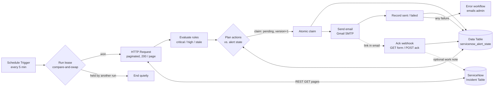

# n8n-epsilon — ServiceNow Incident Monitoring & Alerts

An n8n automation that watches ServiceNow incidents and emails the team the moment one needs attention — built as the Epsilon (Publicis Groupe) automation assignment.

**Authors:** Sanjna J · Manikonda Chethan Krishna

## Problem statement

ServiceNow incidents are tracked manually today. Critical and high-priority tickets, and incidents that sit stale without an update, can go unnoticed between manual console checks. There is no automated path from "an incident needs attention" to "the right person was told."

## Solution

A scheduled n8n workflow polls the ServiceNow Table API every 5 minutes (**paginated, so every open incident is seen**), evaluates each incident against a small set of alert rules (critical, high-priority, stale), claims the alert in a **database-backed state table** *before* sending so the same condition is never emailed twice, and sends a structured notification over Gmail SMTP. Unresolved incidents get **reminders**; an alert nobody **acknowledges** **escalates** to a second and third person; a link in the email **acknowledges** it.

Gmail SMTP (a Google Workspace account + app password) is used instead of Microsoft Teams/Graph notifications because Teams alerts require a Microsoft Entra **client ID and secret**, which personal and student Microsoft accounts cannot provision.

## Architecture



Execution logs and error handling (retries on transient API failures, visible failures in n8n's execution history, an error workflow that emails the administrator) apply across every step.

## Alert rules

| Rule | Condition | Action |
|---|---|---|
| Critical incident | Priority 1 — Critical | Immediate alert; reminders every 10 min until acknowledged; **escalates** at 30 / 60 min |
| High-priority incident | Priority 2 — High | Alert; reminders every 10 min until acknowledged (escalation optional) |
| Stale incident | Unresolved, not updated in 24h | Alert; reminder every 24h |

**State key:** `<incident number>:<alert type>` (e.g. `INC0010042:critical`). Each key is one row in the Data Table.

**Lifecycle:** `pending` (claimed) → `sent` → reminders/escalation → `resolved` when the condition clears; if the condition returns, a *fresh* cycle starts with a new acknowledgement token. An incident that is *In Progress and assigned*, or whose email link was clicked, counts as **acknowledged** and stops reminders and escalation.

## Tech stack

| Component | Role |
|---|---|
| ServiceNow | Incident source — Table API, personal developer instance |
| n8n (Community Edition) | Orchestration — Schedule Trigger, HTTP Request (pagination), Code, Data Table, Webhook nodes |
| ServiceNow REST Table API | Authenticated, field-filtered, **paginated** incident queries |
| Gmail SMTP | Notification delivery — `smtp.gmail.com` + app password |
| **n8n Data Table** | **Alert-state database** (replaces workflow static data) — persists mid-run, shared by overlapping executions, atomic compare-and-swap claims |
| n8n execution history + error workflow | Logging, retries, error visibility, admin notification |

## Repository structure

```
n8n-epsilon/
├── README.md
├── docs/
│   ├── architecture.md            # detailed design doc
│   ├── feedback-response.md       # reviewer feedback -> what changed -> evidence
│   ├── state-store-evaluation.md  # static data vs Data Table vs Postgres
│   └── test-results.md            # executed unit + end-to-end results
├── workflows/
│   ├── servicenow-monitor-setup.json     # run once: table + run lease
│   ├── servicenow-incident-monitor.json  # main workflow (credential-free)
│   ├── servicenow-incident-ack.json      # acknowledgement webhook
│   ├── error-handler.json                # error workflow
│   ├── src/                              # readable Code-node sources (JSON is built from these)
│   └── README.md                         # import + configuration guide
├── scripts/build-workflows.js     # src/ -> workflow JSON
├── tests/                         # unit tests + real-n8n end-to-end reliability suite
├── links.txt                      # reference links
└── .env.example                   # variable names only — never real secrets
```

## Setup

1. Create a [ServiceNow Personal Developer Instance](https://developer.servicenow.com/) and seed it with a few sample incidents across priorities/statuses.
2. Install [n8n Community Edition](https://n8n.io/) locally (or self-hosted).
3. In n8n, add credentials for the ServiceNow REST API (HTTP Basic Auth) and for Gmail SMTP (an [App Password](https://support.google.com/accounts/answer/185833) on a Google Workspace account) — store them in n8n's credential manager, never in the workflow JSON.
4. Import the four workflows from `workflows/`, **run *ServiceNow Monitor - Setup* once** (creates the state table), set the `Config` node values, select the error workflow in the monitor's settings, and publish the error handler, the acknowledgement workflow and the monitor.

Full step-by-step and every setting: [`workflows/README.md`](workflows/README.md).

## Security

- No credentials, tokens, or passwords are committed to this repo.
- Workflow exports in `workflows/` are sanitized before committing.
- A least-privilege ServiceNow account (read-only on `incident`) is used for monitoring; the optional work-note write-back needs write access and is off by default.
- Acknowledge links carry a per-alert secret token, a GET never changes state, and a reopened incident gets a new token.

## Testing

```
cd tests
npm run test:unit    # 55 tests, ~0.5 s — every Code node
npm run test:e2e     # real n8n + mock ServiceNow + SMTP sink, injected failures
```

The end-to-end suite covers concurrent executions, paginated fetches beyond 200 records, ServiceNow
and SMTP failure modes, and a hard kill of n8n mid-send. Results: [`docs/test-results.md`](docs/test-results.md).

| Checklist | Status |
|---|---|
| API connectivity — n8n retrieves incident records | ✅ (mock) · ⏳ live PDI pending |
| Critical / high / stale alerts, normal incident ignored | ✅ |
| Duplicate prevention, including concurrent runs | ✅ |
| Reminders, escalation, acknowledgement (link + auto) | ✅ |
| Pagination beyond 200 records | ✅ |
| Error handling — API/email failures visible, admin emailed | ✅ |
| Persistence — alert state survives an n8n restart | ✅ |
| Crash recovery (killed mid-send) | ✅ |
| Live Gmail delivery / live ServiceNow instance | ⏳ needs real credentials |
