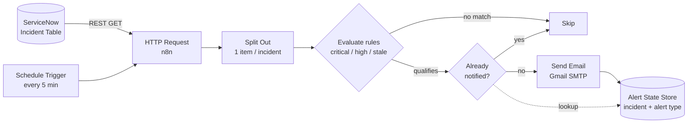

# n8n-epsilon — ServiceNow Incident Monitoring & Alerts

An n8n automation that watches ServiceNow incidents and emails the team the moment one needs attention — built as the Epsilon (Publicis Groupe) automation assignment.

**Authors:** Sanjna J · Manikonda Chethan Krishna

## Problem statement

ServiceNow incidents are tracked manually today. Critical and high-priority tickets, and incidents that sit stale without an update, can go unnoticed between manual console checks. There is no automated path from "an incident needs attention" to "the right person was told."

## Solution

A scheduled n8n workflow polls the ServiceNow Table API every 5 minutes, evaluates each incident against a small set of alert rules (critical, high-priority, stale), checks a persistent dedup store so the same condition is never emailed twice, and sends a structured notification over Gmail SMTP when a rule fires.

Gmail SMTP (a Google Workspace account + app password) is used instead of Microsoft Teams/Graph notifications because Teams alerts require a Microsoft Entra **client ID and secret**, which personal and student Microsoft accounts cannot provision.

## Architecture



Execution logs and error handling (retries on transient API/SMTP failures, visible failures in n8n's execution history) apply across every step.

## Alert rules

| Rule | Condition | Action |
|---|---|---|
| Critical incident | Priority 1 — Critical | Send an immediate alert on detection |
| High-priority incident | Priority 2 — High | Send an alert per configured policy |
| Stale incident | Unresolved, not updated in 24h | Send a reminder |

**Dedup key:** `<incident number>:<alert type>` (e.g. `INC0010042:critical`). A rule that already fired for an incident is skipped on later runs unless the incident's state changes or a reminder interval has elapsed.

## Tech stack

| Component | Role |
|---|---|
| ServiceNow | Incident source — Table API, personal developer instance |
| n8n (Community Edition) | Orchestration — Schedule Trigger, HTTP Request, IF/Filter, Code nodes |
| ServiceNow REST Table API | Authenticated, field-filtered, paginated incident queries |
| Gmail SMTP | Notification delivery — `smtp.gmail.com` + app password |
| n8n Data Table (or equivalent persistent store) | Dedup state — survives restarts |
| n8n execution history | Logging, retries, error visibility |

## Repository structure

```
n8n-epsilon/
├── README.md
├── docs/
│   ├── architecture.md     # detailed design doc
│   └── test-results.md     # test scenarios and results
├── workflows/
│   ├── servicenow-incident-monitor.json  # main n8n workflow (credential-free)
│   ├── error-handler.json                # error workflow
│   └── README.md           # import + configuration guide
├── links.txt               # reference links
└── .env.example            # variable names only — never real secrets
```

## Setup

1. Create a [ServiceNow Personal Developer Instance](https://developer.servicenow.com/) and seed it with a few sample incidents across priorities/statuses.
2. Install [n8n Community Edition](https://n8n.io/) locally (or self-hosted).
3. In n8n, add credentials for the ServiceNow REST API and for Gmail SMTP (an [App Password](https://support.google.com/accounts/answer/185833) on a Google Workspace account) — store them in n8n's credential manager, never in the workflow JSON.
4. Copy `.env.example` to `.env` and fill in your own instance URL and recipient address.
5. Import the workflow from `workflows/`, point it at your credentials, and activate the Schedule Trigger.

## Security

- No credentials, tokens, or passwords are committed to this repo.
- Workflow exports in `workflows/` are sanitized before committing.
- A least-privilege ServiceNow account (read-only on `incident`) is used for monitoring.

## Testing checklist

- [ ] API connectivity — n8n successfully retrieves incident records
- [ ] Critical alert — a priority-1 incident triggers an email
- [ ] Normal incident — a non-qualifying incident doesn't trigger an alert
- [ ] Stale incident — an unresolved incident past the threshold triggers a reminder
- [ ] Duplicate prevention — the same condition doesn't re-trigger an email
- [ ] Error handling — API/email failures are visible in execution history
- [ ] Persistence — alert state survives an n8n restart
